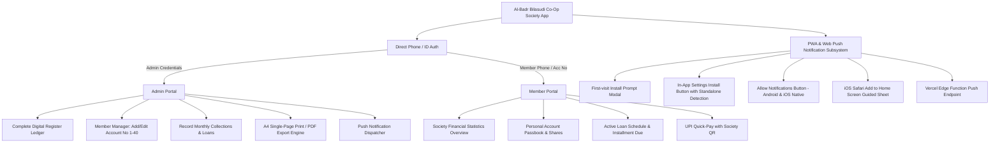

# Comprehensive Implementation Plan: Al-Badr Bilasudi Co-Op Society

## 1. Physical Register Ledger Extraction & Verification

Based on the physical ledger images provided (Image 1: Blank Register Sheet; Image 2: Filled Monthly Register for October 2024), here is the verified transcription of the Society and all 40 members.

### Society Details
* **Society Name (Marathi):** अल-बदर बिलासौदी को.ऑप. सोसायटी, सोलापूर.
* **Society Name (English):** Al-Badr Bilasudi Co-Op Society, Solapur
* **Type:** Mutual Share & Interest-Free Loan Society (बिनव्याजी कर्ज / परस्पर सहाय्य संस्था)
* **Standard Monthly Share (मासिक वर्गणी शेअर्स):** ₹300 per member per month

---

### Ledger Columns Identified (Image 1 & 2)
1. **अकौंट नं.** (Account No.): 1 to 40
2. **नाम** (Member Name)
3. **मासिक वर्गणी शेअर्स रु.** (Monthly Share Contribution): Standard ₹300/-
4. **एकूण शेअर्स जमा रुपये** (Accumulated Share Capital Deposited)
5. **कर्ज मंजूर रुपये** (New Loan Approved / Sanctioned This Month)
6. **कर्जाचा हप्ता रुपये** (Monthly Loan Repayment Installment)
7. **येणे कर्ज बाकी रु.** (Remaining Outstanding Loan Balance)
8. **दंड रु.** (Fine / Penalty for Delay): ₹0 / Nil
9. **एकूण रुपये** (Total Received This Month = Share + Loan Installment + Fine)

---

### All 40 Members Transcription & October 2024 Ledger Data

| अकौंट नं. | नाव (मराठी) | Member Name (English) | मासिक वर्गणी (₹) | एकूण शेअर्स जमा (₹) | कर्ज मंजूर (₹) | कर्जाचा हप्ता (₹) | येणे कर्ज बाकी (₹) | एकूण रुपये (₹) |
|---|---|---|---|---|---|---|---|---|
| **1** | इम्रान सय्यद | Imran Sayyad | 300 | 72,100 | - | 6,000 | 18,000 | 6,300 |
| **2** | युनुस सय्यद | Yunus Sayyad | 300 | 54,100 | - | - | - | 300 |
| **3** | वाजिद गैबू | Wajid Gaibu | 300 | 54,100 | - | 4,000 | 4,000 | 4,300 |
| **4** | आतिक गैबू | Aatik Gaibu | 300 | 54,100 | - | 4,000 | 28,000 | 4,300 |
| **5** | I.Q. Motegaon | I.Q. Motegaon | 300 | 72,100 | - | 6,000 | 1,74,000 | 6,300 |
| **6** | अ.कदीर आळंदकर | A. Qadeer Alandkar | 300 | 54,100 | - | - | - | 300 |
| **7** | आसिफ एलाल | Aasif Elal | 300 | 54,100 | - | 4,000 | Nil | 4,300 |
| **8** | इस्माईल मंगलगीरी | Ismail Mangalgiri | 300 | 54,100 | - | 4,000 | 32,000 | 4,300 |
| **9** | इसा मंगलगीरी | Isa Mangalgiri | 300 | 54,100 | - | 4,000 | 36,000 | 4,300 |
| **10** | इलियास मंगलगीरी | Ilyas Mangalgiri | 300 | 54,100 | - | 4,000 | 40,000 | 4,300 |
| **11** | इम्रान बेंगलोरे | Imran Bengalure | 300 | 54,100 | 1,80,000 | - | - | 300 |
| **12** | जैनोद्दीन बेंगलोरे | Jainoddin Bengalure | 300 | 54,100 | - | - | - | 300 |
| **13** | मुज्जमिल बेंगलोरे | Muzzammil Bengalure | 300 | 54,100 | - | - | - | 300 |
| **14** | जाविद पठाण | Javid Pathan | 300 | 72,100 | - | 6,000 | 12,000 | 6,300 |
| **15** | मोहसिन MMM | Mohsin MMM | 300 | 54,100 | - | 6,000 | 12,000 | 6,300 |
| **16** | अरफान बागवान | Arfan Bagwan | 300 | 54,100 | - | 4,000 | 20,000 | 4,300 |
| **17** | अर्शिया बागवान | Arshiya Bagwan | 300 | 54,100 | - | 4,000 | 20,000 | 4,300 |
| **18** | आयेशा बागवान | Ayesha Bagwan | 300 | 54,100 | - | - | Nil | 300 |
| **19** | मिनाज पठाण | Minaj Pathan | 300 | 54,100 | - | 4,000 | 16,000 | 4,300 |
| **20** | रिजवान पठाण | Rizwan Pathan | 300 | 54,100 | - | 4,000 | 24,000 | 4,300 |
| **21** | वासिद शेख | Wasid Shaikh | 300 | 72,100 | - | 6,000 | 1,62,000 | 6,300 |
| **22** | इलियास तांबोळी | Ilyas Tamboli | 300 | 72,100 | - | 6,000 | 1,44,000 | 6,300 |
| **23** | माफिया तांबोळी | Mafiya Tamboli | 300 | 54,100 | - | 4,000 | 40,000 | 4,300 |
| **24** | जिदान बागवान | Zidan Bagwan | 300 | 72,100 | - | 6,000 | 96,000 | 6,300 |
| **25** | उमर बागवान | Umar Bagwan | 300 | 44,100 | - | - | - | 300 |
| **26** | अली बागवान | Ali Bagwan | 300 | 54,100 | - | - | - | 300 |
| **27** | उस्मान बागवान | Usman Bagwan | 300 | 54,100 | - | 4,000 | 36,000 | 4,300 |
| **28** | महिबूब शेख (दीला) | Mahibub Shaikh (Deela) | 300 | 54,100 | - | - | - | 300 |
| **29** | इनसिया शेख | Insiya Shaikh | 300 | 72,100 | - | 6,000 | 1,26,000 | 6,300 |
| **30** | फारुक मुल्ला | Faruk Mulla | 300 | 72,100 | - | 6,000 | 1,02,000 | 6,300 |
| **31** | इस्माईल मुल्ला | Ismail Mulla | 300 | 72,100 | - | 6,000 | 1,32,000 | 6,300 |
| **32** | इम्रान चौधरी | Imran Chaudhari | 300 | 72,100 | - | 6,000 | 1,38,000 | 6,300 |
| **33** | अब्दुल्ला चौधरी | Abdullah Chaudhari | 300 | 54,100 | - | - | - | 300 |
| **34** | आसिफ प्यारे | Aasif Pyare | 300 | 72,100 | - | 6,000 | 1,68,000 | 6,300 |
| **35** | उमेद प्यारे | Umed Pyare | 300 | 54,100 | - | 4,000 | 8,000 | 4,300 |
| **36** | मतीन बांगी | Matin Bangi | 300 | 54,100 | - | - | - | 300 |
| **37** | जुबेर बक्षी | Zuber Bakshi | 300 | 72,100 | - | - | - | 300 |
| **38** | वाहिद जमादार | Wahid Jamadar | 300 | 72,100 | - | 6,000 | 1,14,000 | 6,300 |
| **39** | गुफरान सय्यद | Gufran Sayyad | 300 | 54,100 | - | 6,000 | 1,56,000 | 6,300 |
| **40** | हारीस जमादार | Haris Jamadar | 300 | 72,100 | - | - | - | 300 |

---

### Monthly Cash Balance Reconciliation (Image 2 Bottom Section)
* **Monthly Shares Collected (40 members × ₹300):** ₹12,000
* **Loan Installments Collected:** ₹1,42,000
* **Total Collection for October 2024 (एकूण जमा):** ₹1,54,000
* **Previous Month Balance Carried Forward (मागील महिना बाकी):** ₹26,820
* **Total Available Cash (एकूण शिल्लक):** ₹1,54,000 + ₹26,820 = **₹1,80,820**
* **New Loan Disbursed to Member #11 (Imran Bengalure):** **₹1,80,000**
* **Closing Balance Carried to Next Month (Current Balance Transfer):** ₹1,80,820 - ₹1,80,000 = **₹820**

---

## 2. Architecture & Design Principles

---

## 3. Detailed Implementation Steps

### Phase 1: Authentication & Single-Society Architecture
1. **Simplified Direct Auth (No Email Verification):**
   - Provide an Admin / Member login interface.
   - Admin logs in with master phone/passcode (e.g. `9800000000` / `admin123`).
   - Members log in with their **Account No** (1 to 40) or **Phone Number** + password/PIN (default `1234` or set by admin).
   - No email confirmation hurdles or Supabase Auth email dependency. Session persisted in localStorage / Supabase custom table.
2. **Society Profile:**
   - Permanent single-society profile: `अल-बदर बिलासौदी को.ऑप. सोसायटी, सोलापूर.`
   - UPI ID and contact numbers configurable by Admin.
3. **TypeScript Fix Completed:**
   - Fixed `src/lib/supabase.ts` error `Property 'env' does not exist on type 'ImportMeta'` by creating [vite-env.d.ts](file:///c:/Users/Administrator/Desktop/All%20projects/Society/src/vite-env.d.ts) and adding `"types": ["vite/client"]` to [tsconfig.json](file:///c:/Users/Administrator/Desktop/All%20projects/Society/tsconfig.json).

---

### Phase 2: Supabase Schema & Migration SQL for Single Society
Create a single SQL script [supabase/migrations/20261025000001_single_society_schema.sql](file:///c:/Users/Administrator/Desktop/All%20projects/Society/supabase/migrations/20261025000001_single_society_schema.sql) that:
1. Creates clean, optimized tables:
   - `society_profile` (name, address, upi, opening_balance)
   - `society_members` (account_no 1-40, name_mr, name_en, phone, password_hash, monthly_share 300, cumulative_shares)
   - `monthly_ledgers` (year, month, previous_balance, total_shares_collected, total_loans_collected, total_loans_disbursed, closing_balance)
   - `ledger_entries` (ledger_id, member_id, account_no, share_amount, loan_sanctioned, loan_installment, loan_balance_remaining, fine, total_amount, is_paid)
   - `push_subscriptions` (user_id, endpoint, keys_p256dh, keys_auth, platform)
2. Seeds all 40 members with their Marathi and English names, Account Numbers 1 to 40, and the initial October 2024 balances directly.

---

### Phase 3: Digital Register Table & Single-Page PDF Print View
1. **Digital Register Section:**
   - A dedicated tab / view in the navigation: **"मासिक नोंदवही (Monthly Register)"**.
   - Displays the exact ledger view identical to Image 1 & Image 2.
   - Shows all 40 rows with quick inline toggles for payment received, loan installment, and loan sanction.
   - Auto-computes summary row (एकूण), previous balance addition, new loan deduction, and closing balance transfer to next month.
2. **Single-Page Print / PDF Download Engine:**
   - Print stylesheet (`@media print`) and PDF download button.
   - Compact, high-density landscape layout designed to fit all 40 rows + header + summary + secretary signature cleanly onto a single A4 / Legal sheet.
   - Includes printable Marathi typography, crisp borders, and society header banner.

---

### Phase 4: Full Society Statistics & Passbook
1. **Statistics View for Members & Admins:**
   - Total Pool Capital (एकूण जमा भांडवल)
   - Active Loans Disbursed vs Outstanding (येणे कर्ज बाकी)
   - Monthly Collection Rate (चालू महिन्याची वसुली)
   - Next Month Projected Disbursal (पुढील महिन्यासाठी उपलब्ध निधी)
2. **Member Passbook:**
   - Cumulative shares graph and history.
   - Active loan repayment countdown progress bar.
   - Download personal monthly receipt.

---

### Phase 5: PWA Installation & Web Push Notifications (Android & iOS)
1. **First-Visit Install Prompt:**
   - Automatically detects if the application is not running in standalone mode.
   - On Android/Desktop Chrome: Captures `beforeinstallprompt` event and shows a custom install banner/modal.
   - On iOS (Safari): Shows a sleek bottom sheet explaining: *"Tap Share  then 'Add to Home Screen'  to install"*.
2. **In-App Settings Controls:**
   - **"Install App" Button:**
     - If already installed (`window.matchMedia('(display-mode: standalone)').matches` or `navigator.standalone`): Clicking shows a toast *"App is already installed on your device"*.
     - If not installed: Triggers native install prompt or opens the iOS instructions guide.
   - **"Allow Notifications" Button:**
     - Checks `Notification.permission`.
     - Prompts user with native Android/iOS permission dialog.
     - Subscribes via `serviceWorkerRegistration.pushManager.subscribe()` using VAPID public key.
     - Saves subscription to Supabase `push_subscriptions`.
3. **Vercel Edge Function for Push Notifications:**
   - Create `api/send-push.ts` (Vercel Edge function) utilizing Web Push standards with user's VAPID keys.
   - Admin can broadcast notices (e.g. *"Monthly contribution of ₹300 due for October"*, *"Loan installment received"*).

---

## 4. Verification Plan

| Test Area | Action & Verification |
|---|---|
| **TypeScript / Build** | `tsc --noEmit` and `npm run build` must succeed with zero errors. |
| **All 40 Members** | Confirm all 40 members match the physical ledger image accurately. |
| **Print / PDF Layout** | Test print preview to ensure all 40 rows fit on a single page cleanly. |
| **Direct Auth** | Test login as Admin and login as Member using Account No/Phone without Supabase email verification. |
| **PWA & Notifications** | Test `beforeinstallprompt`, standalone detection, iOS guide popup, and notification permission request. |
